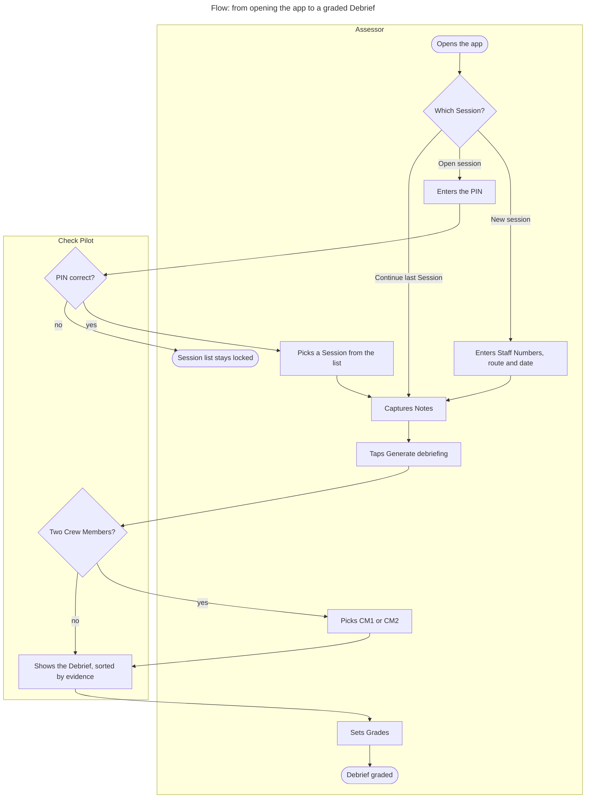

# Functional spec: Check Pilot MVP

## Problem

An Assessor (an instructor, check captain or examiner) observes one or two Crew Members during a flight Sector or a
sim session, and afterwards has to debrief each Crew Member on every Competency with a Grade backed by evidence. In the
cockpit there is no time or room for a laptop or a heavy training platform: the Assessor works one-handed, in low light,
often offline, and in front of the crew, so anything slow, noisy or eye-catching is out. Today the observations end up
on paper or in a generic notes app and have to be re-sorted and re-typed into a debrief afterwards.

## Solution

Check Pilot is a phone app that lets the Assessor start a Session with one or two Staff Numbers and a route, then type
short Notes straight under each Competency, tag each Note to CM1, CM2 or Both, and optionally link one Observable
Behaviour. With one tap the Assessor opens a Debrief per Crew Member: the Competencies are sorted by the evidence about
that Crew Member, the Notes are one tap away, and the Assessor sets a Grade per Competency. Everything is saved as it is
typed and stays on the phone. The Session being worked on is always one tap away from the home screen; every other
saved Session sits behind an app PIN. The Assessor fills in and maintains the real Competencies and Observable
Behaviours in the app itself, starting from a placeholder Catalogue.

_Key: each lane is one actor; rounded boxes start and end the flow, rectangles are actions, diamonds are decisions, and
arrows give the order, each path out of a decision labelled with its answer._

## User stories

### US-1: Start a Session (P1)

As an Assessor, I want to start a Session with the Crew Members' Staff Numbers, the route and the date, so that my
Notes are filed under the right Sector and Crew Members from the first minute.

**Why this priority:** nothing else works without a Session; it is the entry point of every assessment.

**Independent test:** fill in the setup screen and start; the capture screen opens with the route, date and
Competencies.

**Acceptance scenarios:**

1. **Given** the setup screen, **when** the Assessor enters CM1 Staff Number 79125, departure DOH and destination SLL
   and taps Start, **then** the capture screen opens showing "DOH → SLL", today's date, and every Competency of the
   Catalogue in Catalogue order.
2. **Given** the setup screen with both Staff Number fields empty, **when** the Assessor taps Start, **then** no
   Session is created and a message says at least one Staff Number is required.
3. **Given** the setup screen with only the CM2 Staff Number filled in, **when** the Assessor taps Start, **then** the
   Session is created with one Crew Member, in the CM2 slot.
4. **Given** a Staff Number field, **when** the Assessor tries to type a letter, **then** the field accepts only
   digits.
5. **Given** a Staff Number of 3 digits or of 7 digits, **when** the Assessor taps Start, **then** no Session is
   created and a message says a Staff Number has 4 to 6 digits.
6. **Given** a departure or destination field left empty, **when** the Assessor taps Start, **then** no Session is
   created and a message says both airport codes are required.
7. **Given** an airport code that isn't 3 letters, such as "AM" or "AM1", **when** the Assessor taps Start, **then** no
   Session is created and a message says an airport code is 3 letters.
8. **Given** the Assessor types "doh" as departure, **when** the Session starts, **then** the route shows "DOH".
9. **Given** the setup screen, **when** the Assessor picks 01 Nov 2026 in the date picker and starts, **then** the
   capture screen shows 01 Nov 2026.

### US-2: Capture Notes (P1)

As an Assessor, I want to type short Notes straight under a Competency, with a new empty field appearing as I go, so
that I can capture observations in seconds without menus.

**Why this priority:** fast capture in the cockpit is the core value of the app.

**Independent test:** in a started Session, type, erase and empty Notes under one Competency, then reopen the Session.

**Acceptance scenarios:**

1. **Given** a Competency with no Notes, **when** the capture screen shows it, **then** it has exactly one empty Note
   field.
2. **Given** the empty Note field of a Competency, **when** the Assessor types text into it, **then** a new empty Note
   field appears below it.
3. **Given** a Note the Assessor has backspaced to empty and is still typing in, **when** the Assessor keeps typing,
   **then** the Note field stays in place.
4. **Given** a Note backspaced to empty that isn't the last field, **when** the Assessor taps outside it, **then** the
   Note disappears and an undo snackbar appears.
5. **Given** the undo snackbar after an emptied Note disappeared, **when** the Assessor taps Undo, **then** the Note
   comes back in the same place with the text, CM Tag and OBS BEH it had before it was emptied.
6. **Given** a Competency with three Notes and the second one focused, **when** the Assessor taps its ✕, **then** only
   that Note disappears, the other two stay, and an undo snackbar appears.
7. **Given** the undo snackbar after a ✕, **when** the Assessor taps Undo, **then** the Note comes back in the same
   place with its text, CM Tag and OBS BEH.
8. **Given** Notes typed in a Session, **when** the app is closed and the Session is opened again, **then** every Note
   is there, without the Assessor ever having saved.
9. **Given** the capture screen, **when** the Assessor taps Done, **then** the home screen opens.

### US-3: Tag a Note and link an Observable Behaviour (P1)

As an Assessor, I want to say which Crew Member a Note is about and link it to one Observable Behaviour, so that each
Debrief shows the right evidence.

**Why this priority:** without CM Tags and OBS BEH the Debrief can't filter or sort.

**Independent test:** in a Session with two Crew Members, tag Notes and pick OBS BEH, and check what the capture screen
shows.

**Acceptance scenarios:**

1. **Given** a Session with two Crew Members, **when** the Assessor focuses a Note, **then** the CM Tag selector
   CM1 / CM2 / BOTH appears under it with BOTH selected.
2. **Given** a focused Note tagged BOTH, **when** the Assessor taps CM1 and later taps BOTH again, **then** the selector
   shows CM1 selected and then BOTH selected.
3. **Given** one Session with one Crew Member and one with two, **when** the Assessor focuses a Note in each, **then**
   only the Session with two shows the CM Tag selector.
4. **Given** an empty Note field and a Note with text, **when** the Assessor focuses each, **then** only the Note with
   text offers the OBS BEH dropdown.
5. **Given** a Note with text under Competency 3, **when** the Assessor opens the OBS BEH dropdown, **then** it lists
   only Competency 3's OBS BEH, in Catalogue order.
6. **Given** a Note under Competency 3, **when** the Assessor selects OBS BEH 3c, **then** "3c" is shown in small italic
   under the Note and under Competency 3's title.
7. **Given** two Notes under Competency 3 both linked to 3c, **when** the capture screen shows Competency 3, **then** 3c
   appears once under its title.
8. **Given** the only Note linked to 3c, **when** the Assessor sets its OBS BEH to none, **then** 3c disappears from
   under the Note and from under Competency 3's title.

### US-4: Debrief a Crew Member (P1)

As an Assessor, I want a Debrief per Crew Member, sorted by the evidence about them, where I set a Grade per
Competency, so that I can run a structured, evidence-based debriefing without re-typing anything.

**Why this priority:** the Debrief is the outcome the Assessor captures Notes for.

With two Crew Members, a CM1 / CM2 toggle on the Debrief switches between their Debriefs; switching is not leaving
the Debrief.

**Independent test:** in a Session with Notes, generate the Debrief, check the order and the Notes, and set Grades for
both Crew Members.

**Acceptance scenarios:**

1. **Given** a Session with two Crew Members, **when** the Assessor taps Generate debriefing, **then** a pop-up asks
   for the CM 1 or the CM 2 debriefing.
2. **Given** a Session with one Crew Member, **when** the Assessor taps Generate debriefing, **then** that Crew
   Member's Debrief opens directly, with no pop-up.
3. **Given** a Note tagged CM1 and a Note tagged BOTH under Competency 2, **when** the Assessor opens the eye pop-up of
   Competency 2 in each Debrief, **then** CM1's lists both Notes and CM2's lists only the BOTH Note.
4. **Given** Competency 4 has three Notes for CM1 and Competency 1 has one, **when** the CM1 Debrief opens, **then**
   Competency 4 is listed above Competency 1.
5. **Given** Competencies 5 and 6 both have two Notes for CM1, with two different OBS BEH under 6 and the same OBS BEH
   twice under 5, **when** the CM1 Debrief opens, **then** Competency 6 is listed above Competency 5.
6. **Given** two Competencies with the same number of Notes and distinct OBS BEH for CM1, **when** the CM1 Debrief
   opens, **then** they are listed in Catalogue order.
7. **Given** Competencies with no Notes for CM1, **when** the CM1 Debrief opens, **then** they are listed at the bottom,
   in Catalogue order, each with a Grade selector.
8. **Given** a Debrief opened for the first time, **when** the Assessor looks at the Grade selectors, **then** none has
   a Grade, and each offers Not Observed, Exemplary, Effective, Adequate, Minimum Acceptable Level and Not Yet
   Competent, in that order.
9. **Given** a Competency with no Notes, **when** the Assessor sets its Grade to Effective, **then** the Grade is kept.
10. **Given** CM1's Grade for Competency 2 set to Adequate, **when** the Assessor taps CM2 on the Debrief's toggle and
    then CM1, **then** CM2's Competency 2 has no Grade and CM1's still shows Adequate.
11. **Given** a Competency with Notes, **when** the Assessor taps its eye icon, **then** a pop-up lists that Crew
    Member's Notes for the Competency, each with its OBS BEH, and closing it returns to the Debrief.
12. **Given** a Debrief, **when** it opens, **then** a summary header shows the number of Notes, the number of OBS BEH,
    and how many Competencies have a Grade, such as "Grades 6/9".
13. **Given** a Debrief with 3 Competencies without a Grade, **when** the Assessor leaves it with the system back or
    the Debrief's back arrow, **then** a message says "3 Competencies have no Grade" with Leave and Stay; Stay keeps
    the Debrief open and Leave closes it.
14. **Given** a Debrief where every Competency has a Grade, **when** the Assessor leaves it with the system back or the
    Debrief's back arrow, **then** no message appears.
15. **Given** an opened Debrief, **when** the Assessor goes back to capture, adds two Notes for CM1 under the
    lowest-listed Competency, and opens the CM1 Debrief again, **then** that Competency has moved up.
16. **Given** a Debrief, **when** the Assessor changes the date on it, **then** the capture screen shows the new date
    too.
17. **Given** a Debrief, **when** it opens, **then** the CM1 / CM2 toggle is shown with two Crew Members, with the
    opened Crew Member selected, and is not shown with one.
18. **Given** the CM1 Debrief with Competencies without a Grade, **when** the Assessor taps CM2 on the toggle, **then**
    the CM2 Debrief shows and no ungraded-Competencies message appears.

### US-5: Continue the Last Session from the home screen (P0)

As an Assessor, I want the Session I am working on one tap away from the home screen, without a PIN, so that I can get
back to it instantly during or right after the flight.

**Why this priority:** returning to the current Session is the most frequent action after starting one. It comes
first after US-1 because every later story reaches its Sessions, the Session list and Settings through the home
screen it builds.

**Independent test:** create Sessions and check what Continue last Session opens and when it is shown.

**Acceptance scenarios:**

1. **Given** no Session exists, **when** the home screen opens, **then** it shows New session, Open session and
   Settings, and no Continue last Session.
2. **Given** a Session was created, **when** the Assessor taps Continue last Session, **then** that Session opens in the
   capture screen without asking for the PIN.
3. **Given** the Last Session has been deleted, **when** the home screen opens, **then** Continue last Session is not
   shown until the Assessor creates a new Session.

### US-6: Move a Note to another Competency (P2)

As an Assessor, I want to move a Note I filed under the wrong Competency, so that the evidence counts where it belongs.

**Why this priority:** a frequent correction, but capture and Debrief work without it.

**Independent test:** move Notes between Competencies, with and without an OBS BEH, and check both Competencies.

**Acceptance scenarios:**

1. **Given** a Note tagged CM2 under Competency 2, **when** the Assessor moves it to Competency 5, **then** it is gone
   from Competency 2 and appears at the end of Competency 5's Notes, above the empty field, with the same text and CM
   Tag.
2. **Given** a Note linked to OBS BEH 2b, **when** the Assessor moves it to Competency 5, **then** it arrives without an
   OBS BEH and an undo snackbar appears.
3. **Given** the undo snackbar after a move, **when** the Assessor taps Undo, **then** the Note is back in Competency 2
   in its old place, linked to 2b again.
4. **Given** the only Note under Competency 2 linked to 2b, **when** the Assessor moves it to Competency 5, **then** 2b
   no longer appears under Competency 2's title.

### US-7: Find and open a saved Session behind the PIN (P2)

As an Assessor, I want to find an older Session by Staff Number, airport or date behind a PIN, so that I can go back to
past assessments while nobody else holding my phone can.

**Why this priority:** past Sessions matter, but less than capturing and debriefing the current one.

**Independent test:** set a PIN on first use, then search, open and delete Sessions in the list.

**Acceptance scenarios:**

1. **Given** no PIN has been set, **when** the Assessor taps Open session, **then** the app asks for a new 4–6 digit
   PIN, typed twice, and opens the Session list once both match.
2. **Given** the two PIN entries differ, **when** the Assessor confirms, **then** a message says they don't match and
   no PIN is set.
3. **Given** a new PIN of 3 or of 7 digits, **when** the Assessor confirms, **then** a message says a PIN has 4 to 6
   digits and no PIN is set.
4. **Given** a PIN is set, **when** the Assessor taps Open session and enters it correctly, **then** the Session list
   opens.
5. **Given** a PIN is set, **when** the Assessor enters a wrong PIN, **then** a message says the PIN is wrong and the
   Session list stays closed.
6. **Given** the Session list was unlocked, **when** the Assessor opens a Session and goes back to the list, **then**
   the list shows without asking for the PIN.
7. **Given** the Session list was unlocked, **when** the Assessor goes back to the home screen and taps Open session,
   **then** the PIN is asked again.
8. **Given** the Session list was unlocked, **when** the Assessor switches to another app and comes back, **then** the
   PIN is asked again before the list shows.
9. **Given** several Sessions, **when** the Session list opens, **then** they are listed newest first, each row showing
   route, date, Staff Numbers, and how many Competencies have a Grade for each Crew Member.
10. **Given** a Session started with Staff Number 04512, **when** the Session list shows it, **then** the row shows
    "04512".
11. **Given** Sessions with different Staff Numbers, **when** the Assessor searches for 79125, **then** only Sessions
    with Staff Number 79125 are listed.
12. **Given** Sessions on different routes, **when** the Assessor searches for SLL, **then** only Sessions departing
    from or arriving at SLL are listed.
13. **Given** Sessions on different dates, **when** the Assessor picks 08 Nov 2026 in the list's date picker, **then**
    only Sessions dated 08 Nov 2026 are listed, and clearing the date lists all of them again.
14. **Given** a Session in the list, **when** the Assessor opens it for capture or for the Debrief, **then** the
    capture screen or the Debrief of that Session opens.
15. **Given** a Session in the list, **when** the Assessor deletes it, **then** a confirmation asks first; confirming
    removes it from the list, cancelling keeps it.
16. **Given** Session A was created before Session B, **when** the Assessor edits A through the Session list and then
    taps Continue last Session on the home screen, **then** Session B opens.

### US-8: Change or reset the PIN (P2)

As an Assessor, I want to change my PIN, and to start over if I forget it, so that the PIN keeps protecting my
Sessions without locking me out for good.

**Why this priority:** needed once a PIN exists, but rarely used.

**Independent test:** with a PIN set, change it, enter wrong PINs, and use Forgot PIN.

**Acceptance scenarios:**

1. **Given** a PIN is set, **when** the Assessor enters the old PIN and a new PIN twice in Settings, **then** the
   Session list opens with the new PIN and no longer with the old one.
2. **Given** a PIN is set, **when** the Assessor enters a wrong old PIN in Settings, **then** a message says the PIN is
   wrong and the PIN stays unchanged.
3. **Given** 5 wrong PIN entries in a row, **when** the Assessor tries again, **then** a message says to wait 30
   seconds and no PIN can be entered until then.
4. **Given** the PIN screen, **when** the Assessor taps Forgot PIN, **then** a warning says all saved Sessions will be
   deleted, and cancelling deletes nothing.
5. **Given** the Forgot PIN warning, **when** the Assessor confirms, **then** every Session is gone, including the Last
   Session, Continue last Session is no longer shown, and the app asks for a new PIN.
6. **Given** a Catalogue the Assessor has edited, **when** the Assessor confirms Forgot PIN, **then** the Catalogue
   keeps its edits.

### US-9: Edit the Catalogue (P2)

As an Assessor, I want to add, rename, reorder and remove Competencies and Observable Behaviours in the app, so that I
can replace the placeholders with my operator's real Catalogue without a new app.

**Why this priority:** the placeholders are enough to capture and debrief, but real use needs the real names.

**Independent test:** in Settings, change the Catalogue and check the capture screen, the OBS BEH dropdown and an older
Session.

**Acceptance scenarios:**

1. **Given** a fresh install, **when** the Assessor opens the Catalogue editor in Settings, **then** it shows
   Competency 1 to 9, each with OBS BEH a to g.
2. **Given** an existing Session with Notes under Competency 1, **when** the Assessor renames Competency 1 to
   "Communication", **then** that Session and new Sessions show "Communication".
3. **Given** a Catalogue of 9 Competencies and an older Session with all 9 graded for CM1, **when** the Assessor adds a
   Competency, **then** the older Session shows the new Competency without a Grade, and its row in the Session list
   shows 9 of 10 Competencies graded.
4. **Given** Competency 3, **when** the Assessor adds an OBS BEH to it, **then** the new OBS BEH is offered in the
   dropdown of Notes under Competency 3.
5. **Given** the Catalogue editor, **when** the Assessor moves Competency 9 to the top, **then** the capture screen
   lists Competency 9 first, and Debrief ties are broken in the new order.
6. **Given** Competency 3's OBS BEH, **when** the Assessor moves 3g to the top, **then** the dropdown of Notes under
   Competency 3 lists 3g first.
7. **Given** a Competency or OBS BEH that no Note or Grade uses, **when** the Assessor deletes it, **then** it is gone
   from the Catalogue editor and the capture screen.
8. **Given** an OBS BEH that Notes in 4 Sessions use, **when** the Assessor looks at its delete option, **then** it is
   greyed out with "used in 4 Sessions".
9. **Given** Settings, the capture screen and a Debrief, **when** the Assessor looks for the Catalogue editor, **then**
   only Settings offers a way to open it.
10. **Given** a PIN is set, **when** the Assessor opens the Catalogue editor from Settings, **then** no PIN is asked.
11. **Given** an edited Catalogue, **when** the app is updated to a new version, **then** the Catalogue keeps its edits.

### US-10: Duplicate a Session (P3)

As an Assessor, I want to duplicate a Session for the return Sector, so that I don't re-enter the crew and route on a
training flight.

**Why this priority:** saves typing on training return Sectors, but a new Session does the same job.

**Independent test:** duplicate a Session with Notes and Grades and inspect both Sessions.

**Acceptance scenarios:**

1. **Given** a Session DOH → SLL on 01 Nov 2026 with Staff Numbers 79125 and 04512, Notes and Grades, **when** the
   Assessor duplicates it, **then** a new Session SLL → DOH appears at the top of the list, dated today, with Staff
   Numbers 79125 and 04512, no Notes and no Grades.
2. **Given** a duplicated Session, **when** the Assessor opens the original, **then** its route, date, Notes and
   Grades are unchanged.
3. **Given** a Session was just duplicated, **when** the Assessor taps Continue last Session, **then** the duplicate
   opens.

### US-11: Change Staff Numbers after the start (P3)

As an Assessor, I want to add, correct or remove a Staff Number after the Session has started, so that a typo or a
late second Crew Member doesn't force a new Session.

**Why this priority:** a correction path that is rarely needed.

**Independent test:** in a started Session, add, correct and remove Staff Numbers from the capture screen.

**Acceptance scenarios:**

1. **Given** a Session with only CM1 and a Note tagged BOTH, **when** the Assessor adds a CM2 Staff Number on the
   capture screen, **then** focusing a Note shows the CM Tag selector, and the BOTH Note appears in the CM2 Debrief.
2. **Given** a Session with Staff Number 79152, **when** the Assessor corrects it to 79125, **then** the Session list
   shows 79125.
3. **Given** a Session with a Note tagged CM2, **when** the Assessor removes the CM2 Staff Number, **then** the removal
   is refused and a message asks to retag the Notes tagged CM2 first.
4. **Given** a Session where no Note is tagged CM2 and CM2 has no Grade, **when** the Assessor removes the CM2 Staff
   Number, **then** it is removed and focusing a Note no longer shows the CM Tag selector.
5. **Given** a Session with only one Staff Number, **when** the Assessor tries to remove it, **then** the removal is
   refused and a message says at least one Staff Number is required.
6. **Given** a Session where no Note is tagged CM2 and CM2 has Grades, **when** the Assessor removes the CM2 Staff
   Number, **then** a confirmation says CM2's Grades will be deleted; confirming removes CM2 and their Grades, and
   cancelling keeps both.

## Rules

- The app works fully offline; nothing is ever sent to a cloud, server or account.
- Sessions stay on the phone only: there is no backup, restore or export, and no transfer to a new phone.
- Sessions are stored encrypted on the phone.
- The app never makes a sound, never vibrates by default, and offers no voice input.
- Sessions hold text only: no photos, video or other attachments.
- CM1 and CM2 are always labelled CM1 and CM2; they are slots, not seats or roles, and the app holds no names.
- A Note is linked to at most one OBS BEH, always one of its own Competency's.
- The grading scale is fixed; the Assessor can't edit it.
- Every Session, old or new, shows the current Catalogue.
- No Grade is ever set automatically.
- The capture screen uses a dark theme by default, large touch targets and minimal animation, for a dim, vibrating
  cockpit.

## Success criteria

- An Assessor can capture a Note with only a tap on the field and typing; tagging and linking an OBS BEH are optional
  extra taps on the same screen.
- An Assessor can go from the last Note to a sorted Debrief for a Crew Member without re-typing anything.
- An Assessor can run a full sim session or Sector, from setup to every Competency graded for each Crew Member, with
  only this app.
- No saved Session other than the Last Session can be opened without the PIN.

## Assumptions

- The Staff Number search and the date picker filter combine: picking a date and typing a Staff Number lists only the
  Sessions matching both.
- A Competency or OBS BEH the Assessor adds appears at the end of its list until the Assessor moves it.
- Leaving the app (switching to another app) ends the PIN unlock, the same as going back to the home screen.
- Leave on the ungraded-Competencies message returns to the screen the Debrief was opened from.
- The Session list's progress shows each Crew Member's count of graded Competencies separately.
- The Assessor enters the real Competencies and Observable Behaviours, and is responsible for them matching what the
  operator assesses against.
- The owner accepts that a lost or replaced phone loses every Session.
- Using the app for real crew assessments is cleared with the operator's policy on assessment data on personal phones.

## Out of scope

- Backup, restore, export to PDF or text, printing, and sharing.
- Cloud sync, accounts, multiple users, and airline back-end integration.
- A lock on opening the app.
- Editing the grading scale or the app's labels.
- Importing a Catalogue from a file.
- More than one OBS BEH per Note.
- One Session covering several Sectors with their own routes; a Line Check is filed under its outbound Sector.
- Automatic grading, AI-written feedback, and hints comparing Grades with evidence.
- Searching inside Note text.
- A red or low-brightness theme, quick-pick chips for recent Staff Numbers, and airport autocomplete.
- Photos, video, voice input and attachments.
- iOS and web.
