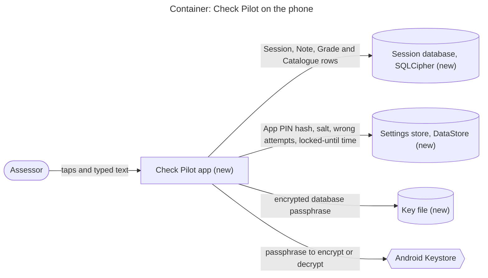
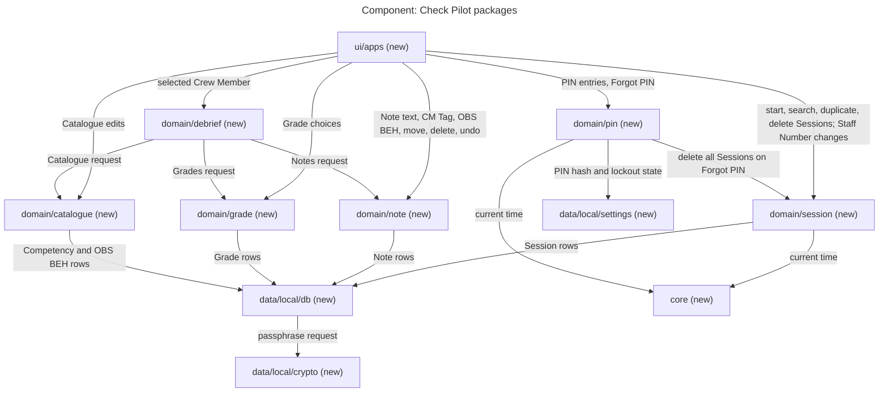
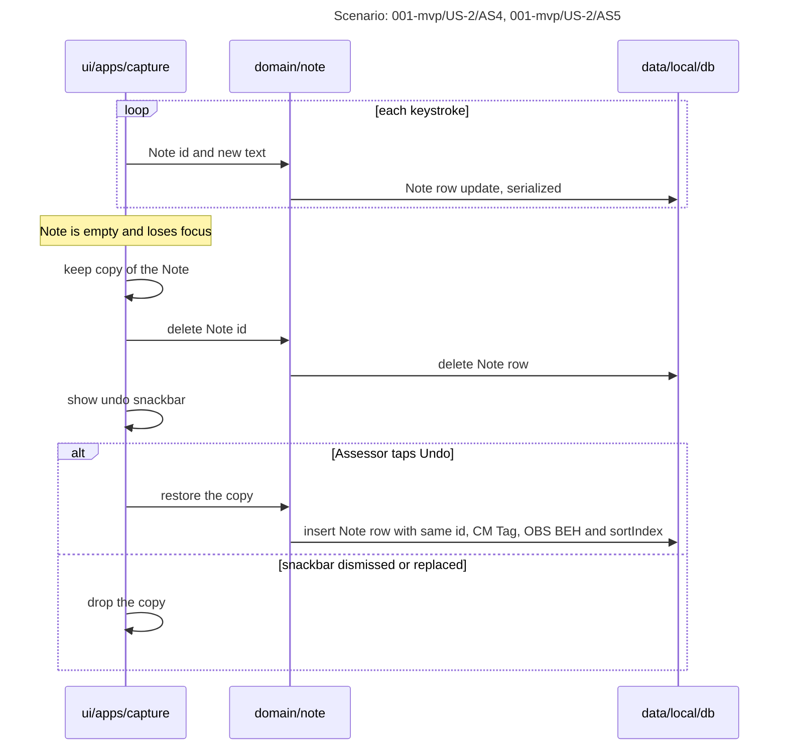
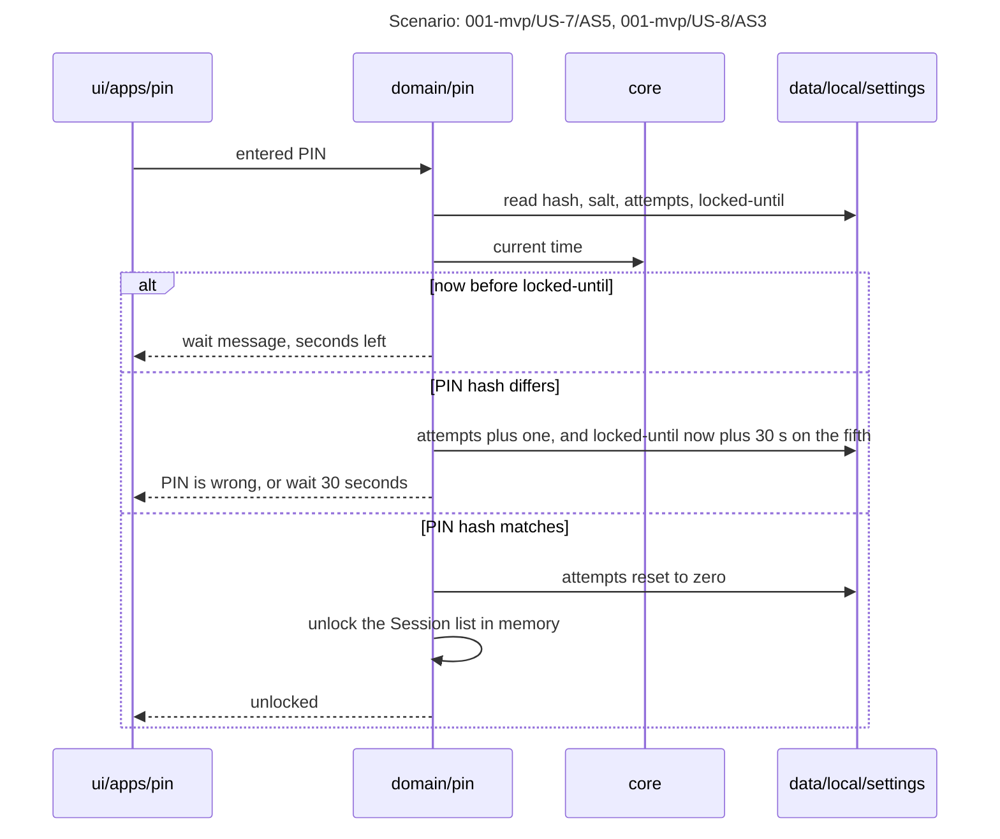
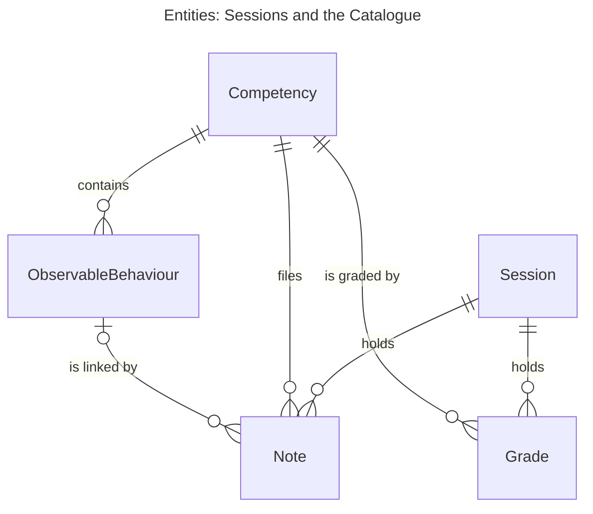

# Technical plan: Check Pilot MVP

## Summary

Check Pilot is built as one native Android app in Kotlin and Jetpack Compose. A single Activity hosts a Navigation 3
back stack, and the code is layered MVVM (`ui/apps` → `domain` → `data/local`) with Koin for dependency injection.
Sessions, Notes, Grades and the Catalogue live in a Room database encrypted with SQLCipher. The App PIN hash and its
lockout state live in DataStore. Nothing leaves the phone. Every edit is written to the database as it happens, and
the Debrief is computed from the Catalogue, the Notes and the Grades each time it opens. Work starts with a thin
skeleton pull request (build setup, an empty app that launches, the database with the placeholder Catalogue, the test
harness). After that, the user stories are built one by one, each once its screens are designed, US-5 straight after
US-1 because the later stories reach their Sessions through it. Every acceptance scenario is tested at one seam: the
whole app running on the JVM under Robolectric.
[Functional spec](functional-spec.md).

## Technical context

- **Language and runtime:** Kotlin through AGP 9's built-in Kotlin support, Java 11 bytecode, single `:app` module.
- **Target:** Android phones, `minSdk` 26, `targetSdk` and `compileSdk` 37. Until the owner names the real device, the
  assumed device is a recent Pixel or Samsung on Android 15 or later. That assumption is recorded in
  `docs/knowledge-base/README.md`. Edge-to-edge (enforced from SDK 35) and predictive back apply.
- **Dependencies to add:**
  - Compose BOM and Material 3
  - Navigation 3
  - Room 2.7+ with KSP
  - `net.zetetic:sqlcipher-android` through Room's `SupportOpenHelperFactory`
  - Koin with koin-compose
  - DataStore Preferences
  - kotlinx-coroutines and kotlinx-serialization
  - Tests: Robolectric, compose-ui-test-junit4, Turbine, kotlinx-coroutines-test, koin-test

  Exact versions are fixed in the skeleton pull request, and every addition goes through the Gradle dependency
  lockfiles.
- **Storage:**
  - an SQLCipher-encrypted Room database file
  - a DataStore Preferences file
  - a key file in `noBackupFilesDir` holding the database passphrase, encrypted with an Android Keystore key
- **Constraints:**
  - The app works fully offline: no network permission and no analytics.
  - `allowBackup="false"`, and the backup and data-extraction rules exclude everything.
  - The app makes no sound and doesn't vibrate.
  - The encryption key must not depend on the phone's screen lock (ADR 0001).
  - Formatting is ktlint, run through spotless (`spotlessApply` and `spotlessCheck`).
- **Robolectric:** tests pin the newest SDK level Robolectric supports through `robolectric.properties`, since
  Robolectric may not support SDK 37 yet.

## Design

### Skeleton (before any story)

One pull request on `main`, with no behaviour the Assessor can see, so that each story's acceptance tests compile and
fail for the right reason. It contains:

- the dependencies above
- a `CheckPilotApplication` that starts Koin, `MainActivity` hosting an empty Navigation 3 back stack, and an empty
  home screen
- the Room database with its five tables, the SQLCipher open-helper factory and the key provider
- the placeholder Catalogue seeded in code in Room's `onCreate` callback
- `allowBackup="false"` and the backup rules
- the test harness (see Testing), one smoke test, and a Koin `verify()` test of the module graph
- `CLAUDE.md` corrected to `spotlessApply` and `spotlessCheck`, `.githooks` with pre-commit `spotlessApply` and pre-push
  `spotlessCheck`, and `docs/knowledge-base/README.md` with the device assumption

### Components

- **`ui/apps/<feature>`.** The feature packages are `home`, `setup`, `capture`, `debrief`, `sessions` (the Session
  list), `pin`, `settings` and `catalogue` (the Catalogue editor). Each has Composables and a ViewModel. Each
  ViewModel exposes `StateFlow` for state and `SharedFlow` for one-off events (snackbars, messages, navigation), and
  calls only `domain` use cases.
- **`ui/generic`.** The shared scaffold, theme and reusable components: the Staff Number and airport-code fields, the
  date field with its Material 3 date picker, the undo snackbar host, and the confirmation dialog.
- **`domain/session`.** Starting, reading, searching, duplicating and deleting Sessions. Changing Staff Numbers after
  the start. The Last Session. Validation of Staff Numbers and airport codes.
- **`domain/note`.** Saving, deleting, restoring and moving Notes. Setting a Note's CM Tag and its OBS BEH. Removing
  empty Notes when a Session opens.
- **`domain/grade`.** Setting a Grade, reading the Grades of a Session, counting graded Competencies.
- **`domain/catalogue`.** Reading the Catalogue and editing it: add, rename, reorder, delete while unused, and the
  "used in N Sessions" count.
- **`domain/debrief`.** A pure use case that builds one Crew Member's Debrief from the Catalogue, the Session's Notes
  and its Grades: filter, sort, the OBS BEH per Competency, and the summary counts.
- **`domain/pin`.** Setting, checking and changing the App PIN. The wrong-attempt lockout. Forgot PIN. The in-memory
  unlock of the Session list.
- **`data/local/db`.** The Room database, entities, DAOs and the `*RepositoryImpl`s for Sessions, Notes, Grades and
  the Catalogue. Also the SQLCipher factory and the seed callback.
- **`data/local/settings`.** The DataStore-backed `PinStoreImpl`.
- **`data/local/crypto`.** `DatabaseKeyProviderImpl`. On first launch it creates a random 32-byte passphrase and
  encrypts it with an Android Keystore AES key that needs no user authentication. It keeps the encrypted bytes in the
  key file and decrypts them when the database opens.
- **`core`.** The `Clock` the app reads the time from, and logging.
- **`di`.** `MainModules.kt` wires everything.

Repository and store interfaces live in their `domain` package; their implementations live in `data/local`. Every use
case, repository and service has an interface, an `Impl` and a `*Fake`, as the project conventions require.

**How the main parts interact:**

- **Writing Notes.** The capture ViewModel holds the text being edited in memory, so a field never re-reads its own
  text from the database. Each change is sent at once to `domain/note`. That use case queues the writes in one
  serialized writer per Session (a single-parallelism dispatcher on its `SupervisorJob` scope), so writes land in the
  order they were typed and nothing waits for a debounce. A Note gets a UUID in the domain layer when its first
  character is typed. The empty trailing field of each Competency exists only in UI state, never as a row.
- **Focus on the capture screen.** Scrolling must never take focus away from a Note. A Note loses focus only when the
  Assessor taps elsewhere, taps ✕, or leaves the screen. The layout itself comes with the designs. A lazy list that
  disposes rows scrolled off screen breaks this rule unless the design works around it.
- **Undo.** Deleting with ✕, removing an emptied Note, and moving a Note are hard deletes or updates. The ViewModel
  keeps a copy of the Note as it was until its snackbar goes away. Undo writes the copy back with the same id, text,
  CM Tag, OBS BEH, Competency and `sortIndex`. A newer snackbar replaces an older one, which makes the older change
  final. If the app is killed while a snackbar shows, that undo is lost.
- **Opening a Session.** `domain/note` deletes the Session's empty Notes first. These are left over when the app was
  killed after a Note was backspaced to empty and before it lost focus.
- **The Debrief.** "Generate debriefing" only navigates; nothing is copied. The Debrief ViewModel holds the selected
  Crew Member. It recomputes the Debrief through `domain/debrief` whenever the Catalogue, the Session's Notes, its
  Grades or the selected Crew Member change.
  - Sorting: most Notes about that Crew Member (CM Tag theirs or Both) first, then most distinct OBS BEH, then
    Catalogue order. The sort is stable.
  - With two Crew Members, a CM1 / CM2 toggle changes the selection in place.
  - A `BackHandler` and the back arrow trigger the ungraded-Competencies message. Using the toggle and sending the app
    to the background don't.
- **The Last Session.** It is the Session with the latest `createdAt`, with ties broken by insertion order. Editing
  never changes it.
- **The PIN unlock.** It is an in-memory flag in `domain/pin`. Two things clear it: the Session list's ViewModel scope
  ends when the back stack returns to the home screen, and `ProcessLifecycleOwner` reports ON_STOP when the app goes to
  the background. "Continue last Session" doesn't check the PIN.
- **Search.** The Session list sends the search text and the optional date to `domain/session`, which runs one SQL
  query. Typed digits match the start of either Staff Number. Typed letters match the start of the departure or
  destination code, ignoring case. The date must match exactly. All conditions combine with AND.

_Key: the rectangle is a program, cylinders are stores, the hexagon is a service of the phone's OS, and the rounded box
is a person; (new) marks what this plan adds; each arrow is labelled with what passes along it._

_Key: each rectangle is a package under `app/src/main/kotlin/com/mebiad/checkpilot`; (new) marks what this plan adds;
an arrow goes from the caller to the package it calls, labelled with what it passes._

_Key: each column is a package; solid arrows are calls, each labelled with what it carries; the loop is the
write-through while typing, and the boxes are the two ways the snackbar ends._

_Key: each column is a package; solid arrows are calls and dashed arrows replies, each labelled with what it carries;
the boxes are the three outcomes of a PIN entry._

## Data model

All of it lives in the Room database except the App PIN, which lives in DataStore.

- **Session:**
  - `id`: UUID text, primary key
  - `createdAt`: instant from the `Clock`
  - `date`: a `LocalDate`, editable
  - `cm1StaffNumber`, `cm2StaffNumber`: nullable text, 4–6 digits, stored exactly as typed. At least one is set.
  - `departureCode`, `destinationCode`: 3 uppercase letters

  There's no status field and no catalogue version. The Last Session query orders by `createdAt` and then by `rowid`,
  both descending.
- **Note:**
  - `id`: UUID text
  - `sessionId`: foreign key, `ON DELETE CASCADE`
  - `competencyId`: foreign key, `RESTRICT`
  - `text`
  - `cmTag`: the code `CM1`, `CM2` or `BOTH`; defaults to `BOTH`
  - `observableBehaviourId`: nullable foreign key, `RESTRICT`
  - `sortIndex`: a Long. A new or moved Note gets the highest index in its Competency plus 1.

  `domain/note` enforces that a Note's OBS BEH belongs to its own Competency, and clears it on a move.
- **Grade:**
  - `sessionId`: foreign key, `ON DELETE CASCADE`
  - `competencyId`: foreign key, `RESTRICT`
  - `crewMember`: `CM1` or `CM2`
  - `value`: a stable code (`NOT_OBSERVED`, `EXEMPLARY`, `EFFECTIVE`, `ADEQUATE`, `MINIMUM_ACCEPTABLE_LEVEL`,
    `NOT_YET_COMPETENT`), never an ordinal

  The primary key is (`sessionId`, `competencyId`, `crewMember`). No row means no Grade. A set Grade can be changed
  but not cleared. Not Observed counts as graded. Removing a Crew Member deletes their Grades.
- **Competency:** `id` (Long, `AUTOINCREMENT`, so never reused), `name`, `sortIndex`.
- **Observable Behaviour:** `id` (Long, `AUTOINCREMENT`), `competencyId` (foreign key), `name`, `sortIndex`.
  - A Competency or OBS BEH can be deleted only while no Note or Grade refers to it. The `RESTRICT` keys back that rule
    up, and `domain/catalogue` checks it first so it can report "used in N Sessions".
  - The `onCreate` seed inserts Competency 1–9, each with OBS BEH a–g. An app update never runs it again.
- **App PIN (DataStore):** a PBKDF2-HMAC-SHA256 hash, its salt, the iteration count, the wrong-attempt count and the
  locked-until instant. The attempt count is shared by the PIN entries on Open session and in Settings, and it survives
  a restart.

_Key: each box is an entity; `||` means exactly one, `|o` zero or one, and `o{` zero or more on that side of the
relationship._

```mermaid
---
title: "State: Note"
---
stateDiagram-v2
    accTitle: States of a Note
    accDescr: A Note starts as the empty trailing field, which exists only on screen. Typing a first character saves it. Backspacing it to empty makes it emptied, and typing again saves it. An emptied Note that loses focus, or is found when its Session opens, is removed; a saved Note is removed by its ✕. Undo restores a removed Note while its snackbar shows.
    [*] --> Trailing: Competency shown
    Trailing --> Saved: first character typed
    Saved --> Emptied: backspaced to empty
    Emptied --> Saved: character typed
    Emptied --> Removed: focus lost, or its Session opened
    Saved --> Removed: ✕ tapped
    Removed --> Saved: Undo tapped
```

_Key: each box is a state of a Note, and each arrow is labelled with the event that moves it; Trailing exists only on
screen, never as a row._

```mermaid
---
title: "State: App PIN"
---
stateDiagram-v2
    accTitle: States of the App PIN and the Session list unlock
    accDescr: With no PIN set, setting a PIN twice opens the list unlocked. A locked list unlocks with the correct PIN; five wrong PINs in a row lock it out for 30 seconds. Going back to the home screen or leaving the app locks it again. Confirming Forgot PIN deletes every Session and returns to no PIN.
    [*] --> NoPin: first install
    NoPin --> Unlocked: new PIN typed twice and matching
    Locked --> Unlocked: correct PIN entered
    Locked --> LockedOut: fifth wrong PIN in a row
    LockedOut --> Locked: 30 seconds passed
    Unlocked --> Locked: home screen reached or app sent to background
    Locked --> NoPin: Forgot PIN confirmed, every Session deleted
```

_Key: each box is a state of the App PIN and the Session list unlock, and each arrow is labelled with the event that
moves it._

## Decisions

This work relies on [ADR 0001](../../adr/0001-pin-on-saved-sessions-instead-of-app-lock.md) (a PIN on saved Sessions,
no app lock, a forgotten PIN wipes them) and [ADR 0002](../../adr/0002-catalogue-editable-on-device.md) (the Catalogue
is edited and stored on the device). It also relies on the stack decisions D18–D24 in the design doc, with D19 revised
below.

- **A skeleton pull request before the stories.** Rationale: acceptance tests must compile and fail before a story is
  built, so the harness, the database and the app shell have to exist first. Alternatives: building it inside US-1
  (too large a story); adding a US-0 to the spec (it has no behaviour the Assessor sees).
- **Stories are built once their screens are designed. Only the skeleton goes ahead now.** Rationale: every story has
  at least one screen, and its acceptance tests run through that screen. Alternatives: build stories on a plain
  Material 3 layout and restyle them later (throwaway work); a thick skeleton with the whole data layer (it would be
  built outside the BDD loop and drift from what the stories need).
- **Navigation 3 instead of Navigation Compose 2.x (revises D19).** Rationale: the back stack is a plain list the app
  owns. That makes "back to the home screen ends the PIN unlock" and the Debrief's leave guard easy to write and to
  test. Alternatives: Navigation Compose 2.x type-safe routes, whose back stack is hidden inside `NavController`.
- **The database passphrase is random and encrypted with a Keystore key that needs no authentication.** Rationale: it
  must not depend on the phone's screen lock (ADR 0001). Alternatives: `EncryptedSharedPreferences` (deprecated); a
  fixed passphrase in the code (no protection).
- **The App PIN is stored as a PBKDF2 hash, and the lockout survives a restart.** Rationale: the PIN never sits in
  plain text, and killing the app doesn't reset the lockout. Alternatives: an in-memory attempt counter (easy to get
  around).
- **Every Note change is written straight away, through one serialized writer.** Rationale: nothing is lost if Android
  kills the process. Alternatives: the design doc's debounce with a flush when the app goes to the background, which
  can lose the last keystrokes.
- **Empty Notes are deleted when a Session opens.** Rationale: only the trailing field is ever empty after a load.
  Alternatives: not saving empty text, so the Note comes back with its old text.
- **UUIDs for Sessions and Notes; `AUTOINCREMENT` ids for the Catalogue.** Rationale: a Note has an id the moment it's
  typed, and Catalogue ids are never reused (ADR 0002). Alternatives: Long ids from the database for everything (an
  asynchronous round trip before a Note has an id).
- **Undo uses an in-memory copy and hard writes. A newer snackbar replaces an older one.** Rationale: no soft-delete
  filter on every query, and no queue of undo snackbars in the cockpit. Alternatives: a soft-delete flag; queued
  snackbars; one snackbar that undoes several changes.
- **Scrolling never takes focus away from a Note. The widget is left to the designs.** Rationale: losing focus removes
  an emptied Note and hides the CM Tag selector. Alternatives: fixing a `Column` with `verticalScroll` now, before the
  designs exist.
- **Search matches the start of a Staff Number or an airport code, combined with the date.** Rationale: it's simple,
  and it covers US-7/AS11–AS13. Alternatives: exact matches only; searching inside Note text (out of scope).
- **The Catalogue is seeded in code in Room's `onCreate`.** Rationale: there's nothing to parse, and it runs once per
  install, so an app update can't overwrite the Catalogue. Alternatives: a bundled JSON asset.
- **Dates always show as `dd MMM yyyy` in English.** Rationale: the app's labels are fixed English, and the spec shows
  "01 Nov 2026". Alternatives: follow the phone's locale.
- **Grades are stored as stable codes, no row means no Grade, and a set Grade can't be cleared.** Rationale:
  reordering the enum can't corrupt saved Sessions, and Not Observed is the deliberate "nothing to grade". Alternatives:
  ordinals; a "No Grade" choice in the selector.
- **Removing a Crew Member with Grades deletes those Grades after a confirmation.** Rationale: keeping them would
  attach one person's Grades to the next Staff Number added to that slot. Alternatives: refusing the removal; keeping
  the Grades hidden.
- **The ktlint rules run through spotless.** Rationale: the build and `.forge/checks.json` are already set up that way.
  Alternatives: the ktlint-gradle plugin (more churn for the same rules).

## Testing

**One seam: the whole app on the JVM.** Each acceptance test launches `MainActivity` under Robolectric with
`createEmptyComposeRule()` and an `ActivityScenario` that the harness owns, so it can restart the app. It drives the
app the way the Assessor does: taps, typed text, the system back and the screen's back arrow, sending the app to the
background. It checks what the screen shows. The harness in `testutils/` starts the
real Koin modules with three overrides:

- an unencrypted Room database in a temporary file, through the plain framework open-helper factory instead of
  SQLCipher, whose native library doesn't load on the JVM
- a `ClockFake` that the test sets and advances
- a `DatabaseKeyProviderFake`

Robolectric runs a test `Application` that leaves Koin to the harness.

- **Given steps** are written straight into the database through the real repositories in the test's Koin graph. This
  keeps tests short and stops one story's tests depending on another story's screens. Where the repository code a
  Given needs comes with a later story, such as deleting a Session (US-7) or editing the Catalogue (US-9), the Given
  writes the rows through the DAO instead. The When and Then always go through the UI.
- **Opening a seeded Session:** a test opens it with Continue last Session (US-5), or through the Session list once
  US-7 is built. There's no test-only entry point into a Session.
- **Finding elements:** by the labels the spec fixes ("Generate debriefing", "Continue last Session", "Grades 6/9",
  the Grade names) and by content descriptions. Test tags only where there's no text, such as an empty Note field.
  Layout, styling and widget types are never checked, so restyling to the designs doesn't break tests.
- **Restarts and updates:** "the app is closed and opened again" and "the app is updated" close the activity and the
  Koin graph and start a new app instance over the same database file and DataStore. For an update, the test checks
  the seed doesn't run again.
- **Background:** "switches to another app and comes back" moves the activity scenario to `CREATED` and back to
  `RESUMED`, which sends ON_STOP through `ProcessLifecycleOwner`.
- **Time:** "today" is the `ClockFake`'s date, and the 30-second lockout is passed by advancing it.
- Each test is labelled with its scenario ID in its doc comment and named after it, as the acceptance-tests skill
  describes.

Below the seam, each story is built test-first with unit tests that use fakes rather than MockK:
`domain/debrief`'s sorting, validation, search matching, PIN hashing and lockout, and the ViewModels. Encryption at
rest is a Rule, not a scenario. One instrumented test under `androidTest` opens the real SQLCipher database with the
real key provider and checks the file can't be read without the passphrase. It sits outside the acceptance suite.

| Scenarios | Seam | How |
|---|---|---|
| `001-mvp/US-1/AS1` to `AS9` | Whole app on Robolectric | Start on the home screen, tap New session, fill in the setup fields and the date picker, tap Start. Check the capture screen, or the validation message and that no Session was created. |
| `001-mvp/US-2/AS1` to `AS9` | Whole app on Robolectric | Seed a Session, open it with Continue last Session, type, backspace, tap away, tap ✕ and Undo. Check the fields and snackbars. AS5 and AS7 seed the Note's CM Tag and OBS BEH in its row, and check the restored row keeps its id, `cmTag`, `observableBehaviourId` and `sortIndex`. AS8 restarts the app over the same database file and reopens the Session with Continue last Session. |
| `001-mvp/US-3/AS1` to `AS8` | Whole app on Robolectric | Seed Sessions with one or two Crew Members and Notes. Focus Notes, tap CM Tags, choose OBS BEH. Check the selector, the dropdown and the italic OBS BEH labels. |
| `001-mvp/US-4/AS1` to `AS18` | Whole app on Robolectric | Seed Notes, CM Tags, OBS BEH and Grades. Tap Generate debriefing, the CM toggle, eye icons, Grade selectors, back and the date. Check the order, pop-ups, header, messages and Grades. |
| `001-mvp/US-5/AS1` to `AS3` | Whole app on Robolectric | Seed zero or more Sessions with set `createdAt`, or delete the Last Session. Check the home screen's buttons and what Continue last Session opens. |
| `001-mvp/US-6/AS1` to `AS4` | Whole app on Robolectric | Seed Notes with and without OBS BEH, move one through its menu, tap Undo. Check both Competencies and their OBS BEH labels. |
| `001-mvp/US-7/AS1` to `AS16` | Whole app on Robolectric | Seed the PIN state and Sessions. Set or enter the PIN, use search and the date picker, open, delete, go home, send the app to the background. Check the list and whether the PIN is asked. AS16 edits a Session from the list and then taps Continue last Session. |
| `001-mvp/US-8/AS1` to `AS6` | Whole app on Robolectric | Seed a PIN, a Catalogue edit and Sessions. Change the PIN in Settings, enter wrong PINs while advancing the `ClockFake`, use Forgot PIN. Check the messages, the Sessions and the Catalogue. |
| `001-mvp/US-9/AS1` to `AS11` | Whole app on Robolectric | Seed Sessions using Catalogue items. Add, rename, reorder and delete in the Catalogue editor. Check the editor, the capture screen, the dropdown, the Debrief order and the Session list. AS11 restarts over the same database file. |
| `001-mvp/US-10/AS1` to `AS3` | Whole app on Robolectric | Seed a Session with Notes and Grades, duplicate it from the list. Check both Sessions and Continue last Session. |
| `001-mvp/US-11/AS1` to `AS6` | Whole app on Robolectric | Seed Sessions with Notes and Grades for CM2. Add, correct and remove Staff Numbers on the capture screen. Check the CM Tag selector, the messages, the confirmation, the CM2 Debrief and the Session list. |

## Structure

- `app/src/main/kotlin/com/mebiad/checkpilot/`
  - `ui/apps/{home,setup,capture,debrief,sessions,pin,settings,catalogue}/`: screens and ViewModels
  - `ui/generic/`: scaffold, theme, shared fields, snackbar host, dialogs
  - `domain/{session,note,grade,catalogue,debrief,pin}/`: use cases, their interfaces and the repository and store
    interfaces
  - `data/local/{db,settings,crypto}/`: Room, DataStore, the key provider
  - `core/`: `Clock`, logging
  - `di/`: `MainModules.kt`
  - `MainActivity` and `CheckPilotApplication` at the package root
- `app/src/test/kotlin/com/mebiad/checkpilot/`
  - `acceptance/`: one file per user story
  - `testutils/`: the acceptance harness, Koin test module, seeding helpers, `MainDispatcherRule`
  - the unit tests and `*Fake`s (such as `core/clock/ClockFake`), mirroring the main packages
- `app/src/androidTest/kotlin/com/mebiad/checkpilot/`: the encryption-at-rest test
- `docs/knowledge-base/`: device and Android-version facts, starting with the device assumption
- `.githooks/`: pre-commit and pre-push hooks

## Story notes

Every story needs the skeleton pull request merged first, and the designs for its screens.

The designs are Variant A in [`designs/`](designs/README.md): one PNG per screen, the look, and what isn't drawn.
Each story's **Designs** line names its PNGs.

### US-1: Start a Session

- **Touches:** `ui/apps/home` (New session), `ui/apps/setup`, a first `ui/apps/capture` showing the route, the date
  and the Competencies, `ui/generic` fields and the date picker, `domain/session` (start, validation),
  `domain/catalogue` (read), `data/local/db`.
- **Blocked by:** none.
- **Designs:** `01-home`, `02-setup`, `21-date-picker`, `03-capture-note-focused` (route, date and Competency
  headings only).

### US-2: Capture Notes

- **Touches:** `ui/apps/capture` (Note fields, trailing field, focus rule, ✕, undo snackbar, Done), `domain/note`
  (serialized writes, delete, restore, cleanup when a Session opens), `data/local/db`.
- **Blocked by:** US-1, US-5.
- **Designs:** `03-capture-note-focused`, `04-capture-writing-note`, `05-capture-end-undo`.

### US-3: Tag a Note and link an Observable Behaviour

- **Touches:** `ui/apps/capture` (CM Tag selector, OBS BEH dropdown, italic labels under the Note and the title),
  `domain/note` (CM Tag, OBS BEH from the Note's own Competency).
- **Blocked by:** US-2.
- **Designs:** `03-capture-note-focused`, `04-capture-writing-note`.

### US-4: Debrief a Crew Member

- **Touches:** `ui/apps/capture` (Generate debriefing, CM pop-up), `ui/apps/debrief` (list, eye pop-up, Grade
  selectors, summary header, CM toggle, leave guard, date), `domain/debrief`, `domain/grade`, `domain/session` (date),
  `data/local/db`.
- **Blocked by:** US-3.
- **Designs:** `05-capture-end-undo` (Done), `06-debrief-pick-cm`, `07-debrief-grade-menu`, `08-debrief-notes-popup`,
  `22-leave-guard`.

### US-5: Continue the Last Session from the home screen

- **Touches:** `ui/apps/home` (Continue last Session, Open session, Settings), `domain/session` (Last Session).
  Open session and Settings are shown and enabled but do nothing yet: US-7 and US-8 wire them.
- **Blocked by:** US-1.
- **Designs:** `01-home`.

### US-6: Move a Note to another Competency

- **Touches:** `ui/apps/capture` (Note menu, Competency picker, undo), `domain/note` (move in one transaction, restore).
- **Blocked by:** US-3.
- **Designs:** `03-capture-note-focused` (move button), `18-move-note`, `05-capture-end-undo` (the undo snackbar after
  a move looks the same).

### US-7: Find and open a saved Session behind the PIN

- **Touches:** `ui/apps/home` (wire Open session), `ui/apps/pin` (set, enter), `ui/apps/sessions` (list, search,
  date filter, open, delete), `domain/pin` (hash, check, unlock, lockout state), `domain/session` (search, delete,
  Grade progress through `domain/grade`), `data/local/settings`, `ProcessLifecycleOwner` wiring.
- **Blocked by:** US-4.
- **Designs:** `13-pin-create`, `09-pin-wrong-entry`, `10-session-list`, `16-session-menu`, `17-delete-session`.

### US-8: Change or reset the PIN

- **Touches:** `ui/apps/home` (wire Settings), `ui/apps/settings` (change PIN), `ui/apps/pin` (lockout message,
  Forgot PIN), `domain/pin` (change, lockout timing, Forgot PIN), `domain/session` (delete every Session),
  `data/local/settings`.
- **Blocked by:** US-7.
- **Designs:** `12-settings`, `13-pin-create`, `09-pin-wrong-entry`, `14-pin-lockout`, `15-forgot-pin`.

### US-9: Edit the Catalogue

- **Touches:** `ui/apps/settings` (entry point), `ui/apps/catalogue`, `domain/catalogue` (add, rename, reorder,
  delete while unused, "used in N Sessions"), `data/local/db`.
- **Blocked by:** US-4, US-7.
- **Designs:** `12-settings`, `11-catalogue-editor`.

### US-10: Duplicate a Session

- **Touches:** `ui/apps/sessions` (duplicate action), `domain/session` (duplicate: Staff Numbers copied, route
  swapped, today's date).
- **Blocked by:** US-5, US-7.
- **Designs:** `10-session-list`, `16-session-menu`.

### US-11: Change Staff Numbers after the start

- **Touches:** `ui/apps/capture` (Staff Number editing, refusal messages, confirmation), `domain/session` (add,
  correct, remove with checks), `domain/grade` (deleting a removed Crew Member's Grades).
- **Blocked by:** US-4, US-7.
- **Designs:** `03-capture-note-focused` (Staff Number chips), `19-edit-staff-number`, `20-remove-crew-member`; the
  "At least one Staff Number is required." refusal isn't drawn (it looks like the one in `19-edit-staff-number`).
